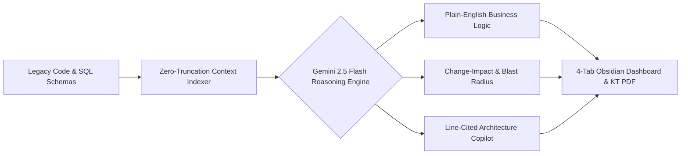

# CodeLens AI — Enterprise Legacy Codebase & Knowledge Transfer Copilot


**CodeLens AI** is an enterprise-grade Legacy Codebase & Knowledge Transfer (KT) Copilot built for engineering teams, solution architects, and IT consulting practices. It ingests undocumented legacy repositories (Java, .NET, PL/SQL, Node, Python) and database schemas to deliver **plain-English business logic maps**, **downstream change-impact blast radius analysis**, **line-cited architectural Q&A**, and **exportable KT dossiers** in seconds.

---

## The Problem

Enterprise organizations maintain mission-critical legacy systems built over 10–15 years with little to no current documentation. When onboarding new engineers or initiating cloud modernization:
* **Discovery Bottleneck:** New developers spend 4 to 8 weeks manually tracing thousands of lines of tightly coupled code just to understand core business rules.
* **High Regression & Outage Risk:** Modifying a single legacy table or stored procedure without knowing downstream consumers frequently breaks production billing, authentication, or reporting pipelines.
* **Lost Tribal Knowledge:** Outdated diagrams force senior architects into repetitive KT sessions instead of high-value feature delivery.

---

## End-to-End Intelligence Pipeline



---

## System Architecture

```text
+-------------------------------------------------------------------+
|               FRONTEND (Next.js App Router + Tailwind)            |
|  [Code/SQL Upload]  [1-Click Sample Repo]  [4-Tab KT Dashboard]   |
+---------------------------------+---------------------------------+
                                  |
                                  v
+-------------------------------------------------------------------+
|                  API LAYER (Next.js Server Routes)                |
|      Multi-File AST / Line-Indexed Context Builder (Full-Pass)    |
+---------------------------------+---------------------------------+
                                  |
                                  v
+-------------------------------------------------------------------+
|               AI REASONING ENGINE (Gemini 2.5 Flash)              |
|  1. Business Rule & Hardcoded Threshold Extraction                |
|  2. Cross-File Dependency & Blast-Radius Risk Scoring             |
|  3. Line-Grounded Q&A & Modernization Roadmap Synthesis           |
+---------------------------------+---------------------------------+
                                  |
                                  v
+-------------------------------------------------------------------+
|                      ACTIONABLE DELIVERABLES                      |
|   [Dependency Graph]   [Line-Cited Chat]   [Exportable KT PDF]    |
+-------------------------------------------------------------------+
```

---

## Key Features & 4-Tab Obsidian Workspace

* **Tab 1 — Executive & Architecture Overview:**
  * Displays overall **Technical Debt Scorecard**, module health KPIs, and high-level system dependency summaries for engineering leads.
* **Tab 2 — Business Logic & Risk Radar:**
  * Side-by-side comparison of *Raw Legacy Code vs. Plain-English Business Rules* with exact file/line citations and hardcoded rule warnings (`Low`, `Medium`, `High` risk).
* **Tab 3 — Change-Impact & Interactive Codebase Copilot:**
  * Evaluates proposed code or schema edits to flag downstream breaking dependencies and lets developers ask natural-language questions (e.g., *"Which services break if we alter `UserAuth`?"*) pinned to exact file paths and line numbers.
* **Tab 4 — KT Dossier & Modernization Blueprint:**
  * One-click export of a formatted **System Architecture & Knowledge Transfer PDF** containing module summaries, risk tables, and phased refactoring milestones.
* **1-Click Legacy Repository Simulation:**
  * Pre-loaded enterprise banking/billing legacy codebase sample for instant live walkthroughs.

---

## Tech Stack

* **Framework:** Next.js (App Router), React, TypeScript
* **Styling & UI:** Tailwind CSS, Lucide Icons (Obsidian Enterprise Dark Theme)
* **AI Engine:** Google Gemini 2.5 Flash API (`@google/generative-ai`)
* **Visualization & Export:** Mermaid Architecture Diagrams & Executive PDF Dossier Generator

---

## Getting Started

### 1. Clone the Repository
```bash
git clone [https://github.com/vishalsukhwall/codelens-ai.git](https://github.com/vishalsukhwall/codelens-ai.git)
cd codelens-ai
```

### 2. Install Dependencies
```bash
npm install
```

### 3. Configure Environment Variables
Create a `.env.local` file in the root directory and add your Google Gemini API key:
```env
GEMINI_API_KEY=your_google_gemini_api_key_here
```

### 4. Run the Development Server
```bash
npm run dev
```
Open [http://localhost:3000](http://localhost:3000) in your browser to launch the CodeLens AI Dashboard.

---

## Business Impact

* **70% Faster Developer Onboarding:** Cuts legacy codebase discovery from weeks to hours with auto-generated plain-English module guides.
* **Zero-Blindspot Refactoring:** Identifies hidden cross-service dependencies and hardcoded business rules before changes reach production.
* **Standardized Knowledge Transfer:** Replaces scattered tribal knowledge with permanent, searchable, and exportable architectural documentation.

---

## License

This project is licensed under the **MIT License** — see the [LICENSE](LICENSE) file for details.
